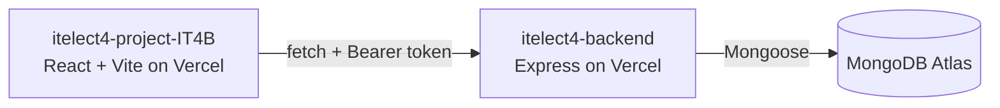

# itelect4-project-IT4B
 

 
The React frontend for the ITELECT4 class demo, end of Session 12: Vite, React 19
and TypeScript, styled with Tailwind CSS v4 and shadcn/ui. It uses React Router
for pages, TanStack Query for server data, Zustand for login state, and
React Hook Form with Zod for validated forms.
 
- **Live app:** https://itelect4-project-it4b.vercel.app
- **Backend repo:** https://github.com/genemaynard25-arch/itelect4-backend
## Architecture
 

 
## Live Deployment
 
- **Live app:** https://itelect4-project-it4b.vercel.app
- **Backend API:** https://itelect4-backend-two.vercel.app
### Environment variables
 
- `VITE_API_URL` - base URL of the backend, no trailing slash
  (local: `http://localhost:4000`, deployed: `https://itelect4-backend-two.vercel.app`)
Vite reads this at build time, so redeploy after changing it.
